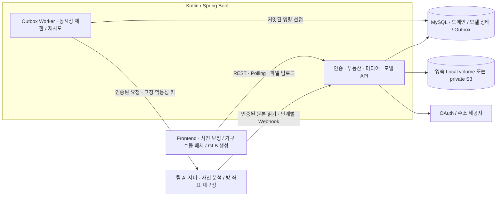

# 사진 4장 기반 3D 부동산 플랫폼 | Backend Portfolio

[](https://github.com/wjs4379/3d-reconstruction-backend-portfolio/actions/workflows/Backend%20CI.yml)

같은 방을 서로 다른 방향에서 찍은 **사진 4장 → AI 분석 → 사용자 보정 → AI 재구성 → 가구 수동 배치 → GLB 저장**을 부동산 매물 탐색에 연결하는 3인 졸업프로젝트입니다.

이 저장소는 백엔드 구현과 검증 방법을 검토할 수 있도록 정리한 공개 포트폴리오입니다. 기존 3D 연동에 **부동산 도메인, 사용자별 권한, 검증된 파일 저장, 비동기 작업 복구, DB 이력·백업**을 추가했습니다. 프론트엔드·AI 서버는 별도 팀 저장소에서 관리하며, 개인 사진·모델·운영 비밀값은 공개본에 포함하지 않습니다.

| 먼저 볼 자료 | 내용 |
| --- | --- |
| [문제 해결 사례](docs/engineering-cases.md) | 문제·설계 선택·검증·남은 한계 |
| [아키텍처](docs/architecture.md) | 도메인 관계와 트랜잭션·파일·AI 경계 |
| [검증 기록](docs/validation.md) | 자동화 검사와 실제 외부 연동의 확인 범위 |
| [API 계약](docs/frontend-api-contract.md) | 현재 V2 API와 프론트·AI 연동 규칙 |

## 구현한 사용자 흐름

1. 로그인한 게시자가 주소를 확인하고 **건물(Property) → 거래 호실(Unit) → 내부 공간(Space)**을 등록합니다.
2. 공간별로 서로 다른 원본 사진 **정확히 4장**을 올립니다. 서버는 소유권·실제 이미지 형식·크기·중복을 검사합니다.
3. 분석 작업을 접수하고, AI가 돌려준 사진별 좌표를 사용자가 사진 위에서 보정합니다.
4. AI가 보정 결과로 최종 방 좌표를 재구성합니다. 프론트는 결과를 표시하고 사용자가 가구를 직접 배치하도록 합니다.
5. 프론트가 생성한 GLB를 서버가 검증·저장합니다. 완료 모델을 매물에 명시적으로 선택하고 공개합니다.
6. 방문자는 매매·전세·월세를 목록·지도에서 찾고 사진·3D를 열람합니다. 로그인 사용자는 관심 매물과 문의를 관리합니다.

가구 배치의 현재 범위는 프론트의 수동 편집과 가구를 포함한 GLB 열람입니다. AI 자동 배치 추천이나 저장된 가구 목록을 다시 편집하는 별도 서버 API는 구현 범위에 없습니다.

## 백엔드에서 해결한 문제

| 기존 문제 | 반영한 설계 | 확인할 코드 |
| --- | --- | --- |
| 건물·방·거래 조건이 섞여 확장하기 어려움 | Property·Unit·Space·Listing 분리, 매물별 거래 조건·상태 | [UnitService](src/main/kotlin/com/hanyang/backend/domain/unit/UnitService.kt), [ListingService](src/main/kotlin/com/hanyang/backend/domain/listing/ListingService.kt) |
| 요청의 작성자 ID나 외부 파일 URL을 신뢰 | JWT 사용자·소유권 검사, 검증된 MediaAsset ID로 연결 | [SecurityConfig](src/main/kotlin/com/hanyang/backend/security/SecurityConfig.kt), [ManagedModelService](src/main/kotlin/com/hanyang/backend/domain/model3d/ManagedModelService.kt) |
| AI 요청이 DB 커밋 직후 유실되거나 과도하게 전달됨 | 분석·보정/재구성 명령을 Outbox에 저장하고 제한된 Worker가 재시도 | [OutboxDispatchService](src/main/kotlin/com/hanyang/backend/domain/model3d/outbox/OutboxDispatchService.kt) |
| 지연 콜백이 최신 상태와 결과를 되돌림 | 모델·단계별 전이 검사, 행 잠금과 조건부 갱신 | [Room3DModelService](src/main/kotlin/com/hanyang/backend/domain/model3d/Room3DModelService.kt) |
| 확장자·파일 크기만으로 업로드를 신뢰 | 실제 이미지·GLB 구조 검증, 불변 최종 키·SHA·S3 버전 기록 | [MediaService](src/main/kotlin/com/hanyang/backend/domain/media/MediaService.kt), [GlbValidation](src/main/kotlin/com/hanyang/backend/domain/media/GlbValidation.kt) |
| 사진 보정이 이미지 밖 좌표나 다른 사진을 참조 | 서버가 확인한 이미지 크기·사진 귀속·원본 점 식별자 검사 | [ManagedModelService](src/main/kotlin/com/hanyang/backend/domain/model3d/ManagedModelService.kt) |
| 재시작·스키마 변경 후 데이터 보존 여부가 불명확 | MySQL/Flyway, 영속 media, 별도 DB 복원·전체 행/DDL·파일 해시 검사 | [Migration](src/main/resources/db/migration), [복원 검사](scripts/verify_local_backup.py) |

## 아키텍처



기능별 패키지와 Controller → Service → Repository 계층을 둔 **모듈형 모놀리스**입니다. 웹 서비스의 정합성은 하나의 MySQL 트랜잭션에서 관리하고, 장시간 GPU 계산은 별도 AI 서버가 담당합니다. 현재 요청 처리에 Redis·Kafka는 사용하지 않습니다.

- **상태와 외부 요청:** 모델 상태와 불변 Outbox 명령을 함께 커밋하고, HTTP 전송은 선점 트랜잭션 밖에서 실행합니다. lease·lock token으로 오래된 Worker의 반영을 막습니다.
- **완료 조건:** AI 최종 좌표 생성은 `WAITING_FOR_MODEL_UPLOAD`, 검증 GLB 연결까지 완료해야 `SUCCESS`입니다. HTTP 접수와 최종 완료를 구분합니다.
- **파일과 DB:** 실제 바이트는 Local/S3, 귀속·크기·해시·버전은 DB에 보존합니다. 업로드 완료 시 검증한 파일을 불변 키로 고정합니다.
- **공개 경계:** 공개 매물에 선택된 사진·완료 모델만 제공합니다. 내부 AI 파일 읽기·Webhook은 서비스 키를 확인하며 공개 nginx 진입에서는 차단합니다.
- **수정 충돌:** 매물의 `expectedVersion`을 확인하고, 문의에는 당시 거래 조건의 스냅샷을 저장합니다.

Outbox는 **at-least-once 전달**입니다. 동일 요청의 재전송이 가능하므로 AI 수신측도 영속 멱등성 처리를 제공해야 합니다. 백엔드의 키 전달만으로 전체 시스템의 exactly-once나 GPU 계산 중간 지점 재개를 보장하지 않습니다.

## 주요 API

관리 API는 `Authorization: Bearer <accessToken>`을 사용합니다. 금액은 원 단위 정수이며 오류 응답은 `{code, message}`입니다.

| 메서드·경로 | 역할 |
| --- | --- |
| POST `/api/auth/kakao/code`, GET `/api/auth/me` | 서버 인가 코드 교환, 로그인 사용자 |
| POST `/api/v2/locations/resolve` | 서버 주소 확인·사용자 귀속 위치 토큰 |
| POST `/api/v2/properties`, POST `/api/v2/units` | 건물·호실 등록 |
| POST `/api/v2/units/{unitId}/spaces` | 내부 공간 등록 |
| POST `/api/v2/media/upload-sessions` | 파일 유형·귀속·크기를 고정한 업로드 세션 |
| PUT `/api/v2/media/upload-sessions/{id}/content` | 인증 바이너리 업로드 |
| POST `/api/v2/media/upload-sessions/{id}/complete` | 실제 파일 검증·완료 모델 연결 |
| POST `/api/v2/spaces/{spaceId}/models/analyze` | 사진 asset ID 4개로 분석 접수 |
| GET `/api/v2/spaces/{spaceId}/models/{modelId}` | 명시적 모델 상태·좌표 조회 |
| POST `/api/v2/spaces/{spaceId}/models/{modelId}/reconstruct` | 사진별 사용자 보정·재구성 접수 |
| GET `/api/v2/listings`, GET `/api/v2/listings/map` | 공개 목록·지도 범위 검색 |
| POST `/api/v2/units/{unitId}/listings` | 거래 매물 초안 생성 |
| POST `/api/v2/listings/{listingId}/publish` | 버전·필수 정보 확인 후 공개 |
| PUT `/api/v2/listings/{listingId}/favorite` | 관심 등록 |
| POST `/api/v2/listings/{listingId}/inquiries` | 문의·거래 조건 스냅샷 저장 |

기존 `/api/rooms/**` 등 요청 본문의 사용자 ID를 신뢰하던 경로는 차단합니다. V2는 단순한 URL 이름 변경이 아니라 인증·귀속·파일·모델 식별 규칙의 변경입니다. 전체 계약은 [API 문서](docs/frontend-api-contract.md)를 참고합니다.

## 공개 저장소만으로 실행하기

필수 환경은 Docker Engine/Compose v2입니다. 기본 Compose는 **백엔드 + MySQL**을 실행하며, 프론트·AI 소스가 없어도 서버 기동과 공개 API·권한 경계를 확인할 수 있습니다.

```sh
cp .env.example .env
# .env의 MYSQL_ROOT_PASSWORD, DB_PASSWORD, JWT_SECRET을 서로 다른 새 값으로 수정
# JWT_SECRET은 최소 32바이트. AI_PIPELINE_ENABLED와 OUTBOX_WORKER_ENABLED는 false 유지

docker compose --env-file .env -f compose.yaml config --quiet
docker compose --env-file .env -f compose.yaml up -d --build --wait --wait-timeout 180
curl --fail http://127.0.0.1:8080/actuator/health/readiness
curl --fail 'http://127.0.0.1:8080/api/v2/listings?page=0&size=5'
curl -i http://127.0.0.1:8080/api/auth/me
```

새 DB에는 Flyway V1–V5가 적용되고 JPA는 `validate`로 일치 여부만 확인합니다. 공개 목록은 빈 결과, 미인증 `/api/auth/me`는 401이 정상입니다. `mysql_data`·`media_data` volume에 DB와 업로드 파일을 보존합니다. 기존 DB를 연결할 때는 별도 백업·복원 환경에서 스키마를 확인한 뒤 적용합니다.

실제 로그인을 시험하려면 같은 Kakao 앱의 ID·REST API 키·Client Secret·등록된 Redirect URI를 비공개 `.env`에 설정해야 합니다. 주소 확인에는 서버용 Local API 설정도 필요합니다. 키가 없으면 OAuth는 503으로 거부합니다. production JAR에는 테스트 로그인용 서버가 포함되지 않습니다.

웹 포함 운영 Compose와 `local_demo.py`는 별도 프론트·AI 저장소 및 추가 실행 환경을 요구하는 팀 통합 도구입니다. `real_integration.py`, `local_ai_connection.py`, `ai_teammate_probe.py`는 실제 OAuth·AI PC 연결의 사전 검사와 관리 도구이며, 준비 검사 통과와 실제 추론 성공은 별도입니다.

## 테스트와 검증 범위

JDK 21·Docker·Python 3.9 이상이 있으면 다음 검사를 실행할 수 있습니다. Gradle은 저장소 Wrapper를 사용합니다.

```sh
./gradlew check bootJar --no-daemon
python3 -B -m unittest discover -s deploy/tests -p 'test_*.py' -v
python3 -B -m unittest discover -s scripts/tests -p 'test_*.py' -v
```

[공개 Backend CI](https://github.com/wjs4379/3d-reconstruction-backend-portfolio/actions/workflows/Backend%20CI.yml)는 API·서비스·JPA·보안·미디어 검사, 실제 MySQL migration, 배포/백업 도구 회귀, Compose 설정과 컨테이너 빌드를 실행합니다. MySQL migration은 Testcontainers를 사용하며 CI에서는 실행 누락·skip을 실패로 처리합니다. Docker 없는 로컬의 일부 검사 성공으로 이를 대체하지 않습니다.

| 구분 | 기록된 확인 범위 | 별도로 필요한 검증 |
| --- | --- | --- |
| 백엔드 자동화 | 권한·도메인·파일·좌표·상태·Outbox·migration 회귀 | 최신 공개 CI 결과와 보고서 확인 |
| 로컬 앱 통합 | 영속 MySQL·테스트 인증/주소·CPU mock으로 사용자 흐름 | 실제 OAuth와 새 사진 GPU 추론 |
| 과거 실제 AI 통합 | 한 공간의 사진 4장 분석·보정·재구성·GLB 저장·조회 기록 | 팀원 PC의 현재 실행본으로 전체 재검증 |
| 가구 표시 | 기존 AI 결과·실제 가구 파일로 표시·GLB 내보내기·뷰어 재생 검사 | 라이브 파일 로드·스케일·실제 저장을 포함한 최신 E2E |
| 배포·보존 | 과거 AWS 공개 조회 preview·재부팅·제한된 별도 복원 기록 | 현재 외부 서비스 접속과 실계정 관리 흐름 |

과거 실 AI 결과는 방 구조의 wireframe이며 면·텍스처·실측 정확도 검증이 아닙니다. 실제 Kakao 로그인과 팀원 PC의 새 추론을 포함한 최신 전체 시연은 남은 통합 항목입니다. 배포 템플릿 제공이나 과거 preview 성공을 상시 운영·고가용성으로 표현하지 않습니다. 날짜·조건별 근거는 [검증 문서](docs/validation.md)에 정리합니다.

[기존 k6/Fake AI 성능 실험](performance/README.md)은 **이전 최초 분석 경로**의 afterCommit 대비 Outbox 전달·응답을 비교한 로컬 기록입니다. 현재 V2 서비스·실 GPU 처리량의 측정 결과와 구분합니다.

## 역할과 AI 도구 활용

백엔드 담당으로 기존 3D 요청 흐름을 부동산 서비스로 확장했습니다. 사진 4장 조건, 지도·공간별 3D 활용, 재시작 후 데이터 보존과 배포 목표, 팀별 수정 범위는 직접 요구하고 조정했습니다.

최근 도메인·인증·파일·복구·운영 도구의 구현·검토·자동화 시험에는 **Codex를 활용**했습니다. 자동화 브라우저/API 검사 결과는 개인의 수동 시연 기록과 구분합니다. 방 분석·재구성 알고리즘과 가중치는 AI 담당자, 사진 보정·가구 편집·GLB 생성 화면은 프론트 담당자의 영역입니다.

## 기술과 다음 통합 단계

Kotlin 2.2.0 · Java 21 · Spring Boot 4.0.3 · MVC/JPA/WebClient · MySQL 8.4 · Flyway · AWS SDK S3 · JUnit 5/Testcontainers · GitHub Actions.

다음 순서는 **동일 Kakao 앱·프론트 V2 계약 정렬 → AI 담당자 PC의 양방향 인증 연결 → 새 사진 4장 분석·보정·재구성 → 실제 가구 배치·GLB 저장 → 공개 매물 재조회**입니다. 예약·결제·전자계약과 AI 자동 가구 추천은 현재 범위에서 제외합니다.
