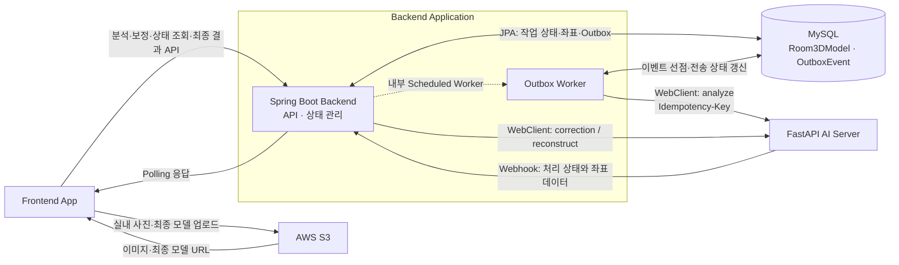
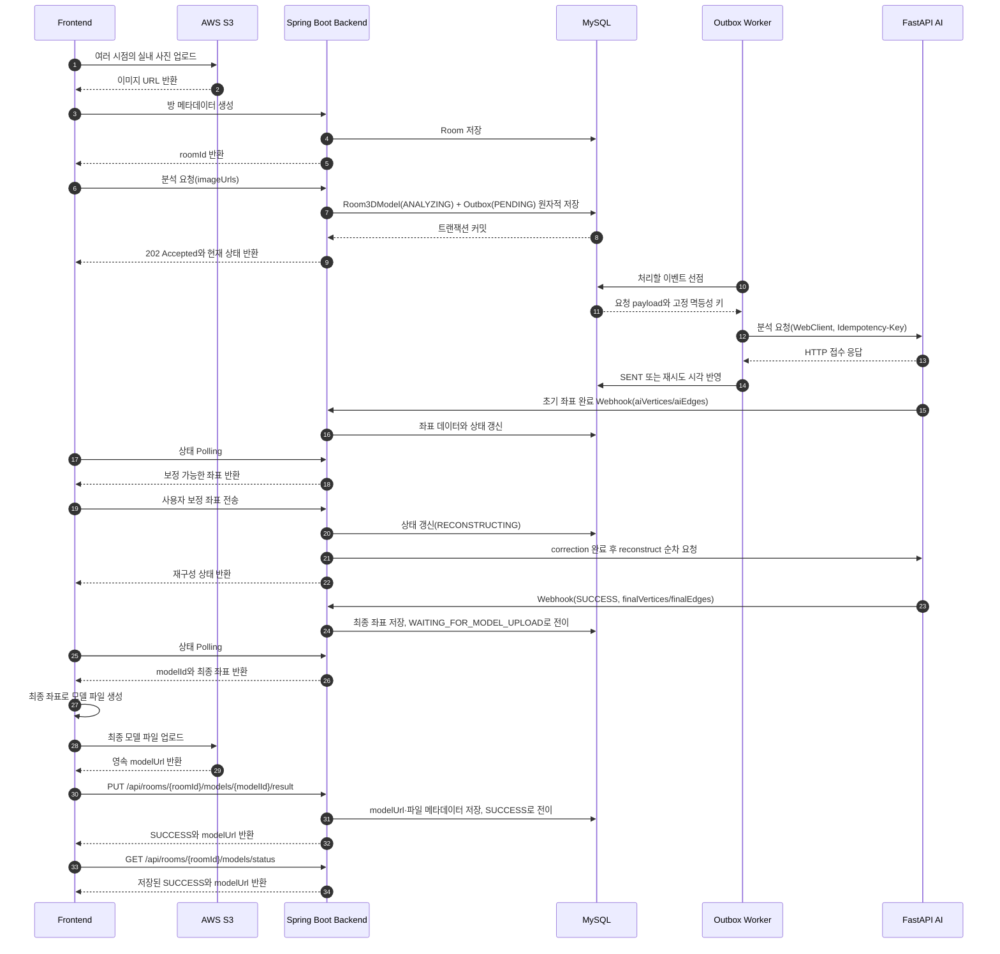
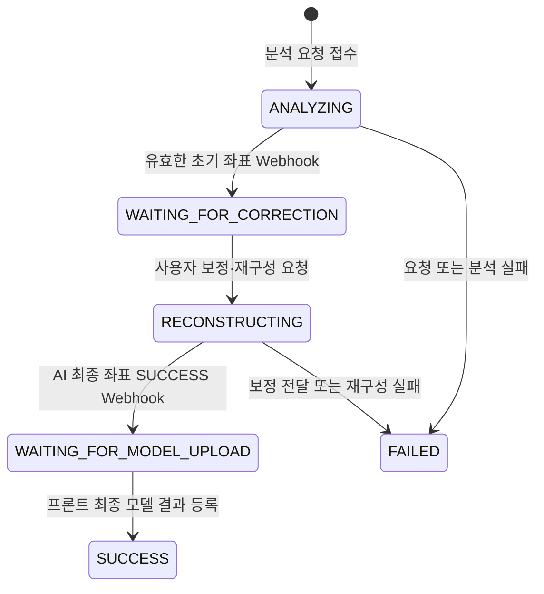

# AI 기반 3D 공간 재구성 플랫폼

[](https://github.com/HY-CSE-GP/BackEnd/actions/workflows/Backend%20CI.yml)

여러 시점에서 촬영한 실내 사진을 분석해 **사용자가 보정할 수 있는 공간 좌표를 생성하고, 최종 3D 모델로 재구성하는 애플리케이션**입니다.

프론트엔드, AI, 백엔드 담당으로 구성된 3인 졸업프로젝트이며, 이 저장소는 Kotlin/Spring Boot 기반 백엔드입니다. 백엔드는 프론트엔드와 FastAPI AI 서버 사이에서 요청 흐름, 상태, 데이터 정합성을 관리합니다.

## 프로젝트 요약

| 구분 | 내용 |
| --- | --- |
| 핵심 기능 | 다중 이미지 분석, 공간 좌표 보정, 3D 모델 재구성 |
| 백엔드 역할 | API 제공, AI 서버 연동, 비동기 작업 상태 관리, 결과 영속화 |
| 팀 구성 | Frontend 1명 · AI 1명 · Backend 1명 |
| 주요 기술 | Kotlin, Spring Boot, JPA, MySQL, WebClient, JUnit 5, GitHub Actions |
| 외부 연동 | 프론트가 업로드한 AWS S3 이미지 URL 전달·최종 모델 URL 저장, FastAPI AI 서버, Webhook |

## 왜 비동기 파이프라인이 필요했는가

AI의 이미지 분석과 좌표 재구성은 처리 시간이 길고, 분석 결과를 사용자가 직접 보정한 뒤 다시 재구성해야 하는 **2단계 AI 작업**입니다. AI가 최종 좌표를 생성한 뒤에는 프론트가 모델 파일을 만들어 영속 저장소에 업로드하는 단계가 이어집니다. 하나의 HTTP 요청에서 AI 결과를 끝까지 기다리면 다음 문제가 생깁니다.

- 처리 시간만큼 프론트 요청이 유지되어 타임아웃과 자원 점유 가능성이 커집니다.
- 1차 분석 완료, AI 최종 좌표 생성, 프론트 최종 모델 업로드를 하나의 `SUCCESS`로 표현하기 어렵습니다.
- 프론트 보정 전후의 작업 상태와 늦게 도착한 Webhook을 일관되게 처리하기 어렵습니다.

이를 해결하기 위해 AI 호출 결과를 기다리는 동기 흐름을 **WebClient 요청 + Webhook 콜백 + 프론트 Polling** 구조로 분리했습니다. 백엔드는 요청 접수 시 작업 상태를 먼저 저장하고, AI 처리 결과는 Webhook으로 받아 갱신합니다. AI의 최종 `SUCCESS`는 좌표 생성 완료를 뜻하며, 프론트가 영속 모델 파일의 URL을 등록해야 백엔드 작업이 최종 `SUCCESS`가 됩니다.

## 시스템 아키텍처



### 전체 처리 흐름



## 주요 상태 흐름

AI 서버가 전달하는 `RenderStatus`는 다섯 가지이지만, 이 값만으로는 1차 분석 완료, 최종 좌표 생성, 프론트 모델 업로드 단계를 구분할 수 없었습니다. 백엔드는 `WAITING_FOR_MODEL_UPLOAD`을 추가한 여섯 가지 `ModelStatus`로 서비스 흐름을 관리합니다.



| 상태 | 의미 | 프론트 동작 |
| --- | --- | --- |
| `ANALYZING` | AI가 업로드 이미지를 분석하는 중 | 상태 Polling |
| `WAITING_FOR_CORRECTION` | 1차 좌표 생성 완료 | 좌표 확인 및 보정 |
| `RECONSTRUCTING` | 보정 데이터를 기반으로 AI가 최종 좌표를 생성하는 중 | 상태 Polling |
| `WAITING_FOR_MODEL_UPLOAD` | AI 최종 좌표 생성 완료 | 최종 좌표로 모델 생성·업로드 후 결과 등록 |
| `SUCCESS` | 프론트가 제공한 영속 모델 URL까지 저장된 완료 상태 | 최종 모델 표시 |
| `FAILED` | 분석 또는 재구성 단계의 AI 요청·처리 실패 | 오류 안내 및 재시도 판단 |

AI의 최종 `SUCCESS` Webhook은 `finalVertices`와 `finalEdges`가 준비됐다는 뜻입니다. 백엔드는 이를 `WAITING_FOR_MODEL_UPLOAD`로 변환하고, 프론트가 좌표로 모델 파일을 생성·업로드한 뒤 `PUT /api/rooms/{roomId}/models/{modelId}/result`로 `modelUrl`을 등록해야 `SUCCESS`로 전이합니다. 백엔드 Webhook 계약은 `modelUrl`을 처리하지 않으며, 최종 URL의 유일한 등록 주체는 프론트입니다.

## 핵심 설계와 트러블슈팅

### 1. 장시간 AI 작업과 HTTP 요청 분리

**문제**

동기 호출에서는 AI 처리가 끝날 때까지 요청이 반환되지 않아 클라이언트 대기 시간과 서버 자원 점유가 길어졌습니다.

**해결**

- 최초 분석 요청은 작업 모델과 Outbox 이벤트를 같은 DB 트랜잭션에 저장하고 먼저 `202 Accepted`를 반환합니다.
- 별도 Worker가 커밋된 Outbox 이벤트를 가져와 `WebClient`로 AI 서버에 전달합니다.
- 사용자 보정·재구성 경로는 `WebClient`가 반환하는 `Mono<Void>`를 연결하고, DB 커밋 뒤 `subscribe`하는 기존 방식을 유지합니다.
- 프론트에는 `ANALYZING` 또는 `RECONSTRUCTING` 상태를 반환하고, AI 좌표 결과는 Webhook으로 수신합니다.
- 최종 좌표가 준비되면 `WAITING_FOR_MODEL_UPLOAD`를 반환하고, 프론트의 모델 업로드 결과는 별도 `PUT` 요청으로 받습니다.
- 최초 분석 전송은 재시도 한도를 모두 소진했을 때만 조건부로 `FAILED`를 반영합니다. 기존 `roomData`가 비어 있을 때는 오류 메타데이터도 함께 저장합니다.

### 2. DB 트랜잭션과 외부 HTTP 요청 분리

**문제**

방과 3D 작업 레코드가 DB에 확정되기 전에 AI 서버가 처리와 Webhook 전송을 시작하면, 아직 조회할 수 없는 식별자를 기준으로 콜백이 도착할 수 있습니다.

**해결**

최초 분석에서는 작업 모델과 전송할 요청 payload를 Outbox에 함께 커밋하고, Worker가 짧은 선점 트랜잭션을 끝낸 뒤 AI HTTP 요청을 수행합니다. 따라서 DB 락을 잡은 채 외부 응답을 기다리지 않습니다.

보정·재구성 경로는 아직 `TransactionSynchronizationManager`의 `afterCommit()`에서 외부 요청을 시작합니다. 이번 개선은 요청 폭주와 프로세스 종료 위험을 먼저 확인한 **최초 분석 경로**에 한정했으며, 후속 경로 확장은 남은 과제입니다.

### 3. 커밋 직후 유실과 AI 서버 과부하를 줄이는 Transactional Outbox

**문제**

기존 `afterCommit + subscribe()` 방식은 DB 커밋 직후 HTTP 전송 전에 프로세스가 종료되면 요청을 복구할 기록이 없습니다. 또한 순간 요청을 제한 없이 AI 서버로 전달해, AI 서버의 처리 용량을 넘은 요청이 `503`으로 거절될 수 있습니다.

**해결**

- `Room3DModel`과 불변 AI 요청 payload를 `OutboxEvent(PENDING)`로 같은 트랜잭션에 저장합니다.
- Scheduled Worker가 짧은 트랜잭션으로 이벤트를 선점하고, HTTP 호출은 트랜잭션 밖에서 실행합니다.
- 단일 인스턴스 기준 전송 동시성을 4개로 제한했습니다.
- `408`, `429`, `5xx`, 네트워크 오류와 타임아웃은 지수 백오프로 재시도하고, 한도를 소진한 경우에만 `DEAD`와 모델 `FAILED`를 반영합니다.
- 각 논리 작업의 멱등성 키를 재시도마다 동일하게 전달합니다.
- lease와 lock token으로 중단된 `PROCESSING` 이벤트를 다시 선점하고, 과거 Worker의 늦은 성공·실패 반영을 차단합니다.
- AI 접수 뒤 `SENT` DB 반영만 실패한 경우에는 작업 실패로 오판하지 않고 lease 만료 후 같은 키로 재전송합니다.

**로컬 반복 실험**

MySQL 8.0, 단일 백엔드 인스턴스, Fake AI 최대 동시 처리 4개·응답 지연 1초 조건에서 k6로 초당 20건을 5초간 발생시켰습니다. 두 방식을 교차 순서로 5회씩 실행하고, 매 회차 프로세스와 DB 상태를 초기화했습니다.

| 지표 | 기존 `afterCommit` | Transactional Outbox |
| --- | ---: | ---: |
| 백엔드 요청/202 | 504 / 504 | 503 / 503 |
| AI 접수 | 106건(21.0%) | 503건(100%) |
| AI `503` 거절 | 398건 | 0건 |
| Webhook 성공 | 106건 | 503건 |
| 백엔드 응답 p95 중앙값 | 933ms | 202ms |
| Fake AI 최대 동시 처리 | 4 | 4 |

별도 강제 장애 실험에서는 Worker 동시성 3, Fake AI 용량 2로 설정했습니다. 21개 작업을 전달하는 동안 10회의 `503`이 발생했지만, 백오프 재시도 후 21개가 모두 `SENT`가 되었고 모델 실패는 없었습니다. 프로세스 재시작 실험에서는 DB에 남겨 둔 `PENDING` 11건이 재시작 후 모두 처리됐습니다.

이 결과는 로컬 제어 환경에서의 관찰값이며 운영 규모의 처리량이나 무유실·exactly-once를 보장하지 않습니다. Outbox는 at-least-once 전달이므로 실제 AI 서버도 멱등성 키를 영속적으로 처리해야 합니다. 세부 조건과 원시 결과는 [`performance/README.md`](performance/README.md)에 정리했습니다.

현재 백엔드는 최초 분석 요청에 고정된 `Idempotency-Key`를 전달하지만, 실제 FastAPI 수신측의 키 영속화와 중복 실행 방지는 아직 구현되지 않았습니다. Fake AI에서 확인한 중복 방지 결과는 실제 FastAPI 검증을 대신하지 않습니다. 수신측은 최초 키만 실행하고, 동일 키·동일 요청에는 기존 상태를 반환하며, 동일 키·상이한 요청은 `409 Conflict`로 거절하도록 계약할 예정입니다. 동시 중복 요청은 DB `UNIQUE` 제약과 원자적인 등록으로 한 번만 접수해야 합니다.

### 4. 비동기 전환 과정의 DB 제약조건 충돌

**문제**

비동기 구조에서는 최초 요청 시점에 `roomData`와 `modelUrl`이 아직 존재하지 않습니다. 기존 스키마의 `NOT NULL` 전제를 유지하면 초기 작업 저장 시 `DataIntegrityViolationException`이 발생했습니다.

**해결**

- 결과 데이터 컬럼을 처리 완료 전까지 `null`을 허용하도록 변경했습니다.
- 먼저 `ANALYZING` 작업을 저장하고, Webhook 도착 시점에는 좌표를, 프론트 최종 결과 등록 시점에는 모델 URL과 파일 메타데이터를 각각 갱신하도록 저장 시점을 분리했습니다.

### 5. 지연 Webhook에 의한 상태 역행 방지

**문제**

네트워크 지연으로 과거 단계의 Webhook이 늦게 도착하면 `RECONSTRUCTING`, `WAITING_FOR_MODEL_UPLOAD` 또는 `SUCCESS`가 다시 이전 상태로 돌아갈 수 있습니다.

**해결**

- 현재 상태와 Webhook 상태를 함께 확인하는 상태 전이 규칙을 적용했습니다.
- `SUCCESS`와 `FAILED`에서는 후속 Webhook이 상태나 결과 필드를 바꾸지 못하게 합니다.
- 현재 단계보다 늦게 도착한 과거 단계의 Webhook은 상태와 결과 필드 모두 반영하지 않습니다.
- Webhook과 프론트 최종 결과 등록은 같은 작업 행에 쓰기 잠금을 사용하고, 비동기 전송 실패는 예상 상태일 때만 조건부로 반영합니다.
- 상태 역행과 존재하지 않는 `aiRoomId` 예외를 단위 테스트로 검증했습니다.

### 6. 보정과 재구성의 실행 순서 보장

correction HTTP 요청을 나타내는 `Mono`가 정상 완료된 뒤 reconstruct HTTP 요청을 전송하도록 Reactor 체인으로 연결했습니다.

```kotlin
aiServerClient.sendCorrection(model.aiRoomId, request)
    .then(aiServerClient.reconstruct(model.aiRoomId))
```

### 7. AI 좌표 생성과 영속 모델 파일 생성의 책임 분리

AI 서버는 재구성된 최종 좌표를 Webhook으로 전달하고, 최종 모델 파일은 프론트가 생성해 S3 등의 영속 저장소에 업로드합니다. 백엔드는 AI `SUCCESS`를 `WAITING_FOR_MODEL_UPLOAD`로 변환해 두 완료 시점을 구분합니다.

프론트는 상태 조회 응답의 `modelId`를 사용해 `PUT /api/rooms/{roomId}/models/{modelId}/result`로 `modelUrl`, `fileSizeMb`, `format`을 전달합니다. 백엔드는 `roomId`와 `modelId` 조합 및 상태를 검증한 뒤 결과를 저장하고 `SUCCESS`로 전이합니다. 같은 URL의 재요청은 멱등하게 처리하고, 완료된 모델의 URL을 다른 값으로 덮어쓰는 요청은 거부합니다.

`PUT` 응답 자체에 최종 `SUCCESS`와 `modelUrl`이 포함됩니다. 프론트가 저장 상태를 다시 확인하려면 `GET /api/rooms/{roomId}/models/status`를 명시적으로 호출하며, 백엔드가 `PUT` 이후 `GET`을 자동 호출하지는 않습니다.

## 담당 범위

백엔드 담당자로서 다음 영역을 설계·구현했습니다.

- Kotlin/Spring Boot 기반 Room·3D Model API와 JPA 영속화
- 프론트의 여러 S3 URL을 AI Swagger의 `imagePaths` 계약으로 변환
- 백엔드 `Long` 사용자 ID를 AI 서버용 결정적 UUID로 변환
- WebClient 기반 분석·보정·재구성 요청과 좌표 결과 Webhook 수신
- `ANALYZING`부터 `SUCCESS`까지 AI 2단계와 프론트 모델 업로드 상태 모델링
- `modelId`로 대상을 고정하는 프론트 최종 모델 결과 등록 API
- 최초 분석 요청의 Transactional Outbox, 동시성 제한 Worker, 재시도·lease·멱등성 키 처리
- 보정·재구성 경로의 트랜잭션 커밋 이후 외부 요청 실행과 비동기 실패 상태 처리
- 지연 Webhook 상태 역행 방지 및 JUnit/Mockito 단위 테스트
- DB/JWT/외부 서버 주소 환경변수화와 OAuth 토큰 로그 제거
- Pull Request 및 `dev/main` push에서 실행되는 GitHub Actions CI 구축

### 핵심 구현 코드

- [Room3DModelService.kt](src/main/kotlin/com/hanyang/backend/domain/model3d/Room3DModelService.kt): 상태 전이, Webhook 반영, 분석 작업과 Outbox 원자적 등록
- [AiServerClient.kt](src/main/kotlin/com/hanyang/backend/domain/model3d/AiServerClient.kt): FastAPI 분석·보정·재구성 API 연동
- [OutboxEvent.kt](src/main/kotlin/com/hanyang/backend/domain/model3d/outbox/OutboxEvent.kt): 전송 상태, 불변 payload, 재시도·lease 정보 모델
- [OutboxDispatchService.kt](src/main/kotlin/com/hanyang/backend/domain/model3d/outbox/OutboxDispatchService.kt): 선점, HTTP 전송, 재시도·최종 실패 처리
- [OutboxWorker.kt](src/main/kotlin/com/hanyang/backend/domain/model3d/outbox/OutboxWorker.kt): 배치 조회와 단일 인스턴스 동시성 제한
- [Room3DModel.kt](src/main/kotlin/com/hanyang/backend/domain/model3d/Room3DModel.kt): 3D 작업 상태와 결과 데이터 모델
- [RoomController.kt](src/main/kotlin/com/hanyang/backend/domain/room/RoomController.kt): 방 메타데이터 생성 API
- [Room3DModelController.kt](src/main/kotlin/com/hanyang/backend/domain/model3d/Room3DModelController.kt): 분석·상태 조회·재구성·최종 결과 등록 API
- [WebhookController.kt](src/main/kotlin/com/hanyang/backend/domain/room/WebhookController.kt): AI 결과 Webhook 수신
- [Room3DModelServiceTest.kt](src/test/kotlin/com/hanyang/backend/domain/model3d/Room3DModelServiceTest.kt): 상태 경계 단위 테스트
- [Room3DModelRepositoryTest.kt](src/test/kotlin/com/hanyang/backend/domain/model3d/Room3DModelRepositoryTest.kt): 조건부 상태 갱신 JPA 통합 테스트
- [Room3DModelWorkflowTest.kt](src/test/kotlin/com/hanyang/backend/domain/model3d/Room3DModelWorkflowTest.kt): 다중 이미지 전달 및 보정·재구성 순서 테스트
- [Backend CI.yml](.github/workflows/Backend%20CI.yml): Gradle 테스트 자동화

## 주요 API

프론트엔드 요청·응답 예시는 [Frontend–Backend 3D API Contract](docs/frontend-api-contract.md)에 정리했습니다.

| Method | Endpoint | 설명 |
| --- | --- | --- |
| `POST` | `/api/rooms` | 방 메타데이터 생성 및 `roomId` 반환 |
| `POST` | `/api/rooms/{roomId}/models/analyze` | 여러 이미지 URL로 분석 시작 |
| `GET` | `/api/rooms/{roomId}/models/status` | 최신 상태와 중간·최종 결과 Polling |
| `POST` | `/api/rooms/{roomId}/models/reconstruct` | 보정 좌표 전달 후 재구성 순차 실행 |
| `PUT` | `/api/rooms/{roomId}/models/{modelId}/result` | 프론트가 업로드한 최종 모델 URL과 파일 메타데이터 등록 |
| `POST` | `/api/rooms/{roomId}/models/refresh` | Webhook 유실 시 AI 상태와 1차·최종 좌표를 다시 조회해 DB에 반영 |
| `POST` | `/api/webhook` | AI 처리 상태와 좌표 결과 수신 |

상태 조회 응답의 `roomData`는 DB에 저장된 JSON 문자열을 객체로 변환해 전달합니다. 프론트는 별도의 `JSON.parse()` 없이 좌표 필드에 접근할 수 있습니다.

## 테스트와 CI

서비스 테스트는 다음 경계를 검증합니다.

- `ANALYZING → WAITING_FOR_CORRECTION`
- AI 최종 좌표 Webhook에서 `RECONSTRUCTING → WAITING_FOR_MODEL_UPLOAD`
- 프론트 최종 모델 결과 등록에서 `WAITING_FOR_MODEL_UPLOAD → SUCCESS`
- AI 최종 좌표 도착 전 모델 URL 등록 거부
- 완료 Webhook의 1차·최종 좌표 JSON 구조 검증
- 유효하지 않은 모델 URL과 일치하지 않는 `roomId`·`modelId` 조합 거부
- 같은 모델 URL 재등록의 멱등성과 완료된 URL 덮어쓰기 방지
- Webhook 유실 시 AI 상태 재조회로 1차·최종 좌표와 다음 대기 상태 복구
- 지연 AI 상태 조회와 Webhook으로 `WAITING_FOR_MODEL_UPLOAD`가 역행하거나 좌표가 덮어써지지 않음
- `SUCCESS` 이후 늦은 `WAITING_FOR_CORRECTION` Webhook에도 상태와 결과 유지
- 존재하지 않는 `aiRoomId` Webhook 예외 처리
- 여러 이미지 URL 전체를 AI `imagePaths`로 전달
- correction 완료 후 reconstruct 요청 실행
- 상태 조회 시 `roomData` JSON 객체 변환
- 중복 경로가 다시 추가되지 않도록 공개 API 매핑 검증
- 실제 JPA에서 예상 상태에만 비동기 전송 실패를 반영하고 기존 좌표를 보존하는 조건부 UPDATE 검증
- 분석 모델과 Outbox 이벤트의 동시 커밋 및 Outbox 저장 실패 시 모델까지 롤백되는 원자성 검증
- 만료 lease 재선점과 lock token 소유자만 `SENT`·재시도·`DEAD`를 반영하는 조건부 갱신 검증
- Worker의 성공 처리, 개별 이벤트 실패 격리, 설정한 최대 동시 전송 수 검증
- 타임아웃·일시적 HTTP 오류의 재시도와 재시도 한도 초과 시 최종 실패 처리 검증

별도의 `BackendApplicationTests`에서 Spring Application Context 로딩을 검증합니다.

```powershell
.\gradlew.bat test --no-daemon
```

GitHub Actions의 `Backend CI`는 다음 이벤트에서 Java 21 환경으로 전체 테스트를 실행합니다.

- `dev`, `main` 대상 Pull Request
- `dev`, `main` push
- 수동 실행(`workflow_dispatch`)

동일 PR의 이전 실행은 자동 취소하며, 실패 시 테스트 리포트를 Artifact로 보관합니다.

## 기술 스택

| 영역 | 기술 |
| --- | --- |
| Language / Runtime | Kotlin 2.2.0, Java 21 |
| Framework | Spring Boot 4.0.3, Spring MVC, Spring WebFlux WebClient |
| Data | Spring Data JPA, MySQL, H2(Test) |
| Async Integration | MySQL Transactional Outbox, Scheduled Worker, Reactor `Mono`, Webhook, Frontend Polling |
| Test / Performance | JUnit 5, Mockito, Spring Boot Test, k6, Fake AI |
| API Docs | Springdoc OpenAPI / Swagger UI |
| Collaboration | Git, Issue 기반 Branch Workflow, GitHub Actions |

## 프로젝트 구조

```text
.
├── src/main/kotlin/com/hanyang/backend/domain
│   ├── model3d          # AI Client, 상태 모델, 3D 작업 API
│   │   └── outbox       # Outbox 이벤트, 선점·재시도, 동시성 제한 Worker
│   ├── room             # 방 생성과 AI Webhook 수신
│   ├── property         # 공간이 속한 건물 정보
│   ├── usage            # 공간 사용 이력
│   └── user             # OAuth 로그인과 JWT 발급
├── performance          # k6·Fake AI 실험 도구와 비교 결과
└── docs                 # API 계약과 백엔드 진행 현황
```

현재 구현 범위와 다음 우선순위는 [백엔드 진행 현황 및 향후 계획](docs/백엔드_진행현황_및_향후계획.md)에 정리했습니다.

## 로컬 실행

### 요구사항

- JDK 21
- MySQL 8
- 3D 변환 흐름 검증 시 실행 중인 AI 서버 또는 접근 가능한 AI 서버 URL

### 환경변수

실제 비밀값은 저장소에 커밋하지 않습니다. `.env.example`을 참고해 IntelliJ Run Configuration 또는 실행 셸에 설정합니다.

| 환경변수 | 기본값 | 설명 |
| --- | --- | --- |
| `DB_URL` | `jdbc:mysql://localhost:3306/spatial_asset_db?...` | MySQL 연결 URL |
| `DB_USERNAME` | `root` | DB 사용자 |
| `DB_PASSWORD` | 없음 | DB 비밀번호 |
| `AI_SERVER_BASE_URL` | `http://localhost:8000` | FastAPI AI 서버 주소 |
| `APP_WEBHOOK_URL` | `http://localhost:8080/api/webhook` | AI 서버가 호출할 Webhook URL. 원격 AI 연동 시 외부 접근 가능한 주소 필요 |
| `JWT_SECRET` | 없음 | 32바이트 이상의 JWT 서명 키 |

> 위 `DB_USERNAME=root`는 로컬 직접 실행의 기본값입니다. Docker Compose 배포에서는 MySQL 공식 이미지의 초기화 규칙 때문에 `root`를 사용하지 말고, `.env.example`처럼 `gp_app` 등의 일반 사용자 이름을 설정합니다.

### 실행 및 확인

기본 연결 설정을 사용한다면 MySQL에 데이터베이스를 먼저 생성합니다.

```sql
CREATE DATABASE IF NOT EXISTS spatial_asset_db
    CHARACTER SET utf8mb4
    COLLATE utf8mb4_unicode_ci;
```

기존 `room_3d_models.status`가 MySQL native `ENUM`으로 생성돼 있다면 새 상태를 사용하기 전에 [상태 컬럼 마이그레이션](docs/sql/20260722-room-3d-model-status-varchar.sql)을 한 번 실행합니다. 새로 생성되는 스키마는 애플리케이션 상태 추가와 충돌하지 않도록 `VARCHAR(40)`을 사용합니다.

```powershell
.\gradlew.bat bootRun
```

Swagger UI:

```text
http://localhost:8080/swagger-ui/index.html
```

## 협업 방식

```text
Issue 생성 → dev 기반 자동 브랜치 생성 → 구현·테스트 → PR → dev 병합
```

| 작업 유형 | Issue prefix | Branch prefix |
| --- | --- | --- |
| 기능 | `[feature]` | `feature/` |
| 버그 | `[fix]` | `bugfix/` |
| 리팩터링 | `[refactor]` | `refactor/` |
| 문서 | `[docs]` | `docs/` |
| 테스트 | `[test]` | `test/` |
| 설정 | `[chore]` | `chore/` |

`main`에는 `dev`만 병합하고, 기능·문서 브랜치는 `dev`를 대상으로 Pull Request를 생성합니다.

## 다음 개선 계획

- 실제 FastAPI의 `Idempotency-Key` 영속화·중복 실행 방지 구현 및 EC2 환경 E2E 검증
- Webhook HMAC 또는 공유 시크릿 검증
- Outbox를 사용자 보정·재구성 요청 경로에도 확장
- 다중 백엔드 인스턴스에서의 전역 AI 동시성 제한과 MySQL `SKIP LOCKED` 기반 선점 검증
- `SENT` 이벤트 보존 기간·정리 정책과 Flyway/Liquibase 스키마 마이그레이션 도입
- Polling 응답 경량화와 상태 조회용 DB 인덱스 추가
- 여러 작업이 동시에 생성될 때 상태 조회·보정 요청도 `modelId` 기준으로 대상을 명확히 구분
- Frontend–Backend–AI 전체 E2E 자동화 및 Docker Compose 실행 환경 구성
