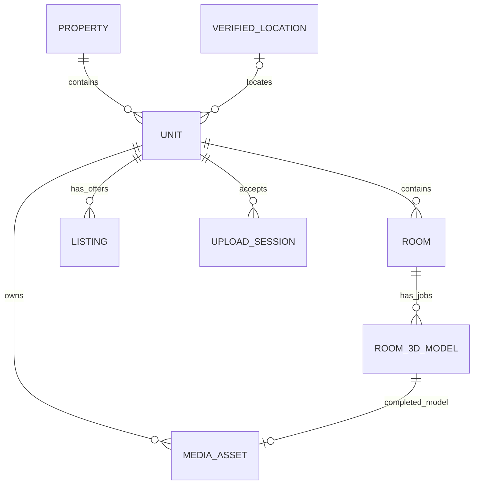
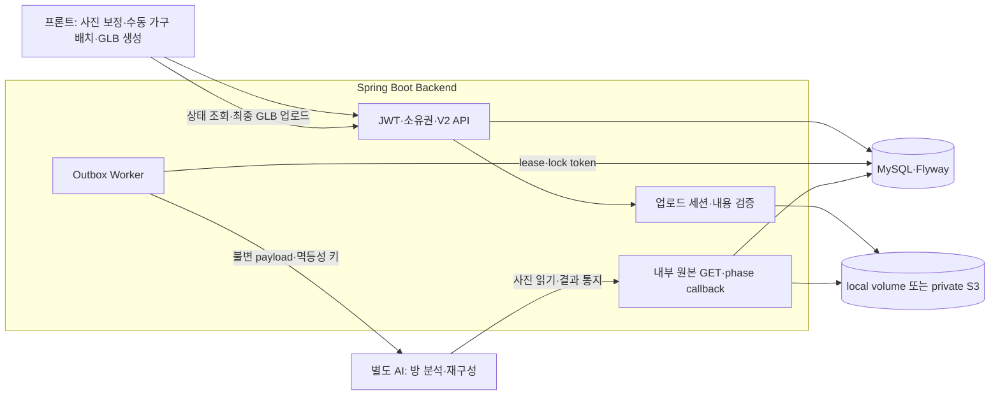

# 부동산 도메인과 3D 작업 아키텍처

공개 코드의 책임과 경계를 설명한다. AI/프론트 소스·가중치·사용자 사진·운영 환경값은 포함하지 않는다. 실제 실행과 한계는 [검증 기록](validation.md)을 본다.

## 도메인을 분리한 이유

| 모델 | 책임 | 구분한 이유 |
|---|---|---|
| Property | 건물 | 한 건물의 여러 호실을 묶음 |
| Unit | 소유·관리하는 호실, 면적·입주 정보·위치 공개 범위 | 소유권과 원본 공간의 기준 |
| Room / API의 space | 거실·침실 등 호실 안의 공간 | 공간별 사진과 3D 작업을 독립 관리 |
| Room3DModel | 특정 공간의 분석·보정·재구성 작업 | 최신 작업에 덮어쓰지 않고 modelId로 결과 고정 |
| MediaAsset / UploadSession | 업로드 접수와 검증된 사진/모델 | 업로드 중인 파일과 공개 가능한 불변 자산 구분 |
| Listing | 매매·전세·월세 조건, 게시 상태, 선택한 사진/완료 모델 | 원본 공간과 광고 게시의 생명주기 분리 |
| VerifiedLocation | 서버가 확인한 주소·좌표 | 클라이언트 임의 좌표를 신뢰하지 않음 |

이 그림은 책임 관계를 요약한다. 사진 자산은 sourceModelId가 없을 수 있고, 공간별 모델 선택은 Listing의 선택 데이터로 보관한다. 실제 제약은 [엔티티](../src/main/kotlin/com/hanyang/backend/domain/)와 [Flyway SQL](../src/main/resources/db/migration/)을 기준으로 한다.

## 요청과 저장 흐름

AI는 사진별 보정점과 최종 점·선·viewerUp을 반환한다. AI 최종 SUCCESS는 GLB 저장 완료가 아니므로 백엔드는 WAITING_FOR_MODEL_UPLOAD로 전이한다. 프론트가 파일을 만들고 서버가 실제 GLB를 검증·보존한 뒤 최종 SUCCESS가 된다. AI 가구 자동 추천과 실사 텍스처 복원은 현재 완료 범위가 아니다.

사진 단계 좌표는 원본 사진 내부 X/Y·Z=0이다. imageIndex/sourceVertexId와 원본 표시 크기를 확인하며 재구성 뒤 3D 좌표와 구분한다. 화면 중앙 정렬과 저장하는 원본 좌표를 분리한다. viewerUp만으로 미터 단위·실측 정확도를 보증하지 않는다.

## 비동기 신뢰성

분석과 보정/재구성 모두 모델 상태 변경과 불변 Outbox payload를 같은 트랜잭션에 커밋한다. Worker는 짧은 선점 트랜잭션 뒤 외부 HTTP 요청을 보낸다.

- 논리 작업의 Idempotency-Key는 재전송에도 동일하다.
- 일시 오류는 백오프로 재시도하고 한도 초과는 DEAD로 처리한다.
- lease와 lock token으로 중단 작업을 재선점하고 이전 Worker의 늦은 기록을 거부한다.
- 보정 성공 뒤 재구성 순서를 보장한다. 외부 접수 후 SENT 반영만 실패한 경우 같은 키로 복구한다.
- callback의 phase·현재 상태·좌표 구조를 대조해 지연된 과거 응답의 결과 덮어쓰기를 막는다.

at-least-once 전달이며 실제 중복 실행 방지는 AI 수신측의 영속 멱등성 처리까지 맞춰야 한다. 동시성 제한은 단일 백엔드 인스턴스 기준이다. exactly-once나 전역 분산 제한을 주장하지 않는다.

## 권한·파일·데이터 보존

JWT principal로 호실·공간·작업·파일 소유권을 검사한다. 업로드는 staging과 검증된 자산을 분리하고 동일 완료 요청은 기존 자산을 반환한다. 공개 매물에서 선택된 자산만 공개 경로로 제공한다. 사용자 사진/GLB는 공개 가구 카탈로그와 분리한다.

AI 내부키는 브라우저에 전달하지 않는다. 원본 GET·callback은 내부 인증과 허용 origin을 사용하고 공개 프록시에서 내부 경로를 차단한다. DB는 Flyway V1~V5와 ddl-auto=validate, 자동 baseline 비활성으로 관리한다.

기본 [compose.yaml](../compose.yaml)은 공개 저장소만으로 빌드하는 backend/MySQL 구성이다. 웹 포함 compose.prod/compose.aws 예제는 별도 프론트 소스가 필요하다. local_demo.py도 호스트 도구와 형제 AI/FrontEnd 저장소를 전제로 한 팀 시연 보조 도구이며 기본 실행 경로가 아니다. fixture 인증은 테스트 클래스에만 있고 production JAR에 포함하지 않는다.
