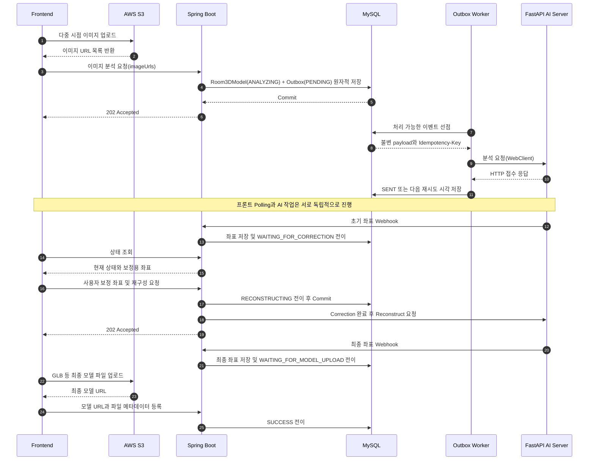

# 백엔드 진행 현황 및 향후 계획

- 업데이트: 2026-08-10
- 기준 브랜치: `dev` (`d1ed87c`)
- 연구 과제: 다중 시점 RGB 이미지를 활용한 실내 공간의 3D 재구성 및 가상 인테리어 에셋 배치가 가능한 부동산 공유 플랫폼 개발
- 담당: Backend
- 기술 스택: Kotlin, Spring Boot, Spring Data JPA, MySQL, WebClient, Reactor, JUnit 5, GitHub Actions, k6

---

## 1. 한눈에 보는 현재 상황

백엔드는 프론트엔드와 FastAPI AI 서버 사이에서 이미지 분석, 사용자 보정, 3D 재구성, 최종 모델 업로드로 이어지는 작업 흐름을 상태 기반으로 관리한다. 장시간 AI 작업은 최초 HTTP 요청과 결과 수신을 분리하고, AI 결과는 Webhook으로 반영하며 프론트는 3초 Polling으로 진행 상태를 확인한다.

최초 이미지 분석 요청에는 MySQL Transactional Outbox와 동시성 제한 Worker를 적용했다. `Room3DModel`과 AI 요청 payload를 같은 트랜잭션으로 저장한 뒤 Worker가 AI 서버의 처리 용량에 맞춰 전달하며, 일시적 실패는 백오프로 재시도한다.

### 구현 및 검증 완료

- Spring Boot 웹 서버와 FastAPI AI 서버를 분리한 HTTP 연동 구조
- 여러 이미지 URL을 전달하는 분석 요청과 `202 Accepted` 응답
- Webhook 결과 수신과 프론트 상태 Polling API
- `ANALYZING → WAITING_FOR_CORRECTION → RECONSTRUCTING → WAITING_FOR_MODEL_UPLOAD → SUCCESS` 상태 흐름
- 지연·중복 Webhook과 동시 갱신에 대한 상태 역행 방지
- 비관적 락, 허용된 상태 전이, 조건부 갱신
- 프론트가 생성한 최종 모델 URL과 파일 메타데이터 등록
- 최초 분석 모델과 Outbox 이벤트의 원자적 저장
- Scheduled Worker의 단일 인스턴스 동시성 제한, lease, lock token
- HTTP 타임아웃, 일시적 오류 재시도, 지수 백오프, 최종 실패 처리
- 같은 Outbox 이벤트의 모든 재시도에 고정된 `Idempotency-Key` 전달
- Fake AI와 k6를 이용한 기존 방식·Outbox 방식 반복 비교
- 프로세스 재시작 후 DB에 남은 미처리 이벤트 복구 확인
- 54개 자동화 테스트와 `dev` GitHub Actions CI 통과
- Docker Compose·Nginx 기반 EC2 백엔드 배포 구성

### 부분 구현 또는 미구현

- Outbox 적용 범위는 최초 이미지 분석이며, 사용자 보정·재구성은 기존 `afterCommit + WebClient` 방식
- 실제 FastAPI는 아직 `Idempotency-Key`를 저장하거나 중복 실행을 차단하지 않음
- FastAPI가 EC2에 배포되지 않아 실제 Frontend–Backend–AI 전체 E2E는 미검증
- 단일 백엔드 인스턴스의 동시성만 제한하며, 다중 인스턴스 전역 제한은 미구현
- `SENT` Outbox 이벤트의 보존·삭제 정책과 명시적 DB migration이 없음
- AI 원본 좌표, 사용자 보정 좌표, 최종 좌표를 독립된 버전으로 저장하지 않음
- 상태 Polling 응답이 `roomData` 전체를 포함해 경량화와 인덱스 검증이 필요
- 핵심 API의 JWT 검증·소유권 인가와 Webhook 인증이 미완성
- 실제 운영 트래픽·실제 AI 서버를 대상으로 한 성능 수치는 없음

> **핵심 정리:** 최초 분석 요청의 유실 가능성과 AI 요청 폭주를 줄이기 위한 Transactional Outbox는 백엔드에 구현하고 로컬 제어 환경에서 검증했다. 다음 단계는 실제 FastAPI의 멱등성 수신 계약을 구현하고 EC2 환경에서 전체 흐름을 검증하는 것이다.

---

## 2. 백엔드 담당 범위

백엔드는 다음 역할을 담당한다.

- 방 및 3D 모델 작업 데이터 저장
- 프론트가 S3에 업로드한 이미지 URL을 AI 서버 계약에 맞게 전달
- 장시간 AI 분석·재구성 작업 접수
- AI Webhook 수신 및 현재 작업 상태 갱신
- 초기 좌표, 최종 좌표, 최종 모델 URL 관리
- 지연·중복 결과와 동시 갱신으로 인한 데이터 불일치 방지
- 사용자가 현재 작업 단계를 조회할 수 있는 API 제공
- AI 서버의 처리 용량에 맞춘 최초 분석 요청 전달과 재시도

이미지와 최종 3D 모델 파일 자체는 MySQL에 저장하지 않는다. 프론트가 S3에 직접 업로드하고, 백엔드는 파일 URL과 필요한 메타데이터를 관리한다.

---

## 3. 현재 전체 처리 흐름



현재 상태 흐름은 다음과 같다.

```text
ANALYZING
→ WAITING_FOR_CORRECTION
→ RECONSTRUCTING
→ WAITING_FOR_MODEL_UPLOAD
→ SUCCESS

AI 분석 또는 재구성 단계에서 복구할 수 없는 오류
→ FAILED
```

프론트의 Polling 주기는 현재 3초다. 부하를 계산할 때는 전체 가입자 수가 아니라 실제 AI 작업을 진행하며 Polling 중인 사용자 수를 기준으로 한다.

---

## 4. 주요 구현 내용

### 4.1 비동기 상태 기반 작업 흐름

초기에는 하나의 HTTP 요청에서 AI 결과까지 기다리는 흐름을 고려했지만, 이미지 분석과 3D 재구성은 처리 시간이 길다. 최초 요청과 완료 시점을 다음과 같이 분리했다.

- 백엔드는 작업을 접수하고 현재 상태와 `202 Accepted`를 반환
- AI는 작업 완료 후 Webhook으로 좌표와 상태를 전달
- 프론트는 3초 Polling으로 현재 상태와 결과를 조회
- AI의 최종 좌표 생성과 프론트의 최종 모델 파일 업로드를 서로 다른 상태로 구분

### 4.2 상태와 데이터 정합성 관리

- Webhook 처리 시 해당 `aiRoomId` 행에 비관적 락 적용
- 현재 상태에서 허용된 다음 상태만 반영
- 늦은 분석 Webhook이 재구성 결과와 상태를 과거 단계로 되돌리지 못하도록 차단
- 늦게 실행된 WebClient 오류 콜백은 예상 상태에서만 조건부로 `FAILED` 반영
- 최종 모델 URL이 있어야 `WAITING_FOR_MODEL_UPLOAD → SUCCESS` 전이 가능

### 4.3 비동기 전환 과정의 DB 제약 변경

동기식 설계에서는 최종 결과를 한 번에 저장하므로 좌표와 모델 URL에 `NOT NULL`을 적용할 수 있었다. 비동기식으로 바꾸자 최초 작업 저장 시점에는 결과가 존재하지 않아 `DataIntegrityViolationException`이 발생했다. 데이터가 아직 생성되지 않았다는 의미를 명확하게 표현하도록 관련 결과 필드를 nullable로 변경하고, 상태 전이 규칙에서 완료 조건을 검증한다.

### 4.4 Transactional Outbox

기존 `afterCommit + subscribe()` 방식에는 두 가지 한계가 있었다.

1. DB 커밋 직후 AI HTTP 요청 전에 프로세스가 종료되면 요청을 복구할 기록이 없다.
2. 순간 요청이 모두 AI 서버로 전달되어 AI 처리 용량을 넘으면 다수의 요청이 거절될 수 있다.

최초 분석 경로를 다음과 같이 변경했다.

- `Room3DModel`과 불변 AI 요청 payload를 `OutboxEvent(PENDING)`로 같은 트랜잭션에 저장
- Worker가 짧은 트랜잭션으로 이벤트를 선점한 뒤 DB 트랜잭션 밖에서 HTTP 호출
- 단일 백엔드 인스턴스 기준 최대 동시 전송 수 4개
- `408`, `429`, `5xx`, 네트워크 오류, 타임아웃은 지수 백오프로 재시도
- 재시도 한도를 소진한 경우에만 Outbox를 `DEAD`, 모델을 조건부 `FAILED`로 변경
- lease 만료 시 중단된 `PROCESSING` 이벤트 재선점
- lock token 소유자만 늦은 성공·실패 결과를 반영
- AI 접수 후 `SENT` 기록만 실패하면 작업 실패로 오판하지 않고 동일 키로 재전송

Outbox 상태는 다음과 같다.

```text
PENDING → PROCESSING → SENT
                   ↘ DEAD

lease 만료 또는 일시적 실패
PROCESSING → PENDING
```

### 4.5 멱등성 키의 현재 범위

백엔드는 Outbox 이벤트를 처음 생성할 때 고정된 멱등성 키를 만들고 모든 재시도에서 다음 헤더로 전달한다.

```http
Idempotency-Key: <outbox-event-uuid>
```

이것만으로 중복 실행이 방지되는 것은 아니다. Outbox는 at-least-once 전달이므로 실제 FastAPI가 키를 영속적으로 저장하고 다음 계약을 지켜야 한다.

- 최초 키: 작업 접수 정보를 저장한 뒤 한 번만 분석 실행
- 동일 키·동일 요청: 다시 실행하지 않고 기존 상태 반환
- 동일 키·상이한 요청: `409 Conflict`
- 동시 중복 요청: DB `UNIQUE` 제약과 원자적 저장으로 하나만 접수
- `202 Accepted`: 멱등성 키와 작업 접수 정보가 영속화됐다는 의미

현재 실제 FastAPI 수신측에는 이 처리가 구현되지 않았다. Fake AI의 멱등성 실험 결과를 실제 FastAPI 검증으로 표현하지 않는다.

---

## 5. 성능·안정성 비교 실험

### 5.1 실험 조건

- 실행일: 2026-08-10
- 단일 로컬 백엔드 인스턴스
- MySQL 8.0.30
- Fake AI 최대 동시 처리 4개
- Fake AI 응답 지연 1초
- k6 `constant-arrival-rate` 20 RPS × 5초
- 기존 방식과 Outbox 방식을 교차 순서로 각각 5회 실행
- 매 회차 프로세스와 DB 상태 초기화

### 5.2 반복 실험 결과

| 지표 | 기존 `afterCommit` | Transactional Outbox |
| --- | ---: | ---: |
| 백엔드 요청/202 | 504 / 504 | 503 / 503 |
| AI 접수 | 106건(21.0%) | 503건(100%) |
| AI `503` 거절 | 398건 | 0건 |
| Webhook 성공 | 106건 | 503건 |
| 백엔드 응답 p95 회차 중앙값 | 933ms | 202ms |
| Fake AI 최대 동시 처리 | 4 | 4 |

기존 방식의 398건은 조용히 유실된 요청이 아니라 Fake AI가 `503`으로 거절하고 기존 로직이 모델을 `FAILED`로 기록한 요청이다. Outbox 방식에서는 API 요청 경로가 외부 전송과 실패 콜백 처리에서 분리되고, Worker가 AI 용량에 맞춰 전달했다.

### 5.3 장애 주입 결과

- Worker 동시성 3, Fake AI 용량 2 조건에서 21개 논리 작업 전달
- AI HTTP 호출은 재시도를 포함해 31회
- 첫 시도에서 발생한 `503` 10건이 두 번째 시도에서 처리
- 최종 Outbox `SENT` 21건, 모델 `FAILED` 0건
- 프로세스 재시작 후 DB의 `PENDING` 11건 모두 처리
- ACK 유실 상황에서 동일 키 재전송 시 HTTP 102회, 중복 감지 1회, 고유 실행 101회

### 5.4 결과의 한계

- 단일 PC·단일 백엔드 인스턴스·Fake AI 환경의 관찰값
- 운영 규모의 처리량이나 무유실을 보장하지 않음
- Outbox가 exactly-once를 보장하지 않음
- 실제 FastAPI의 멱등성 영속 처리와 실제 AI 연산 비용은 미검증
- p95 감소가 모든 환경에서 재현된다고 일반화하지 않음
- 현재 Outbox 적용 범위는 최초 분석 요청

세부 실행 방법과 결과는 [`../performance/README.md`](../performance/README.md)와 [`../performance/results/COMPARISON.md`](../performance/results/COMPARISON.md)에 정리한다.

---

## 6. API와 테스트

### 6.1 주요 API

| Method | Endpoint | 설명 |
| --- | --- | --- |
| `POST` | `/api/rooms` | 방 메타데이터 생성 |
| `POST` | `/api/rooms/{roomId}/models/analyze` | 여러 이미지 URL 분석 요청 |
| `GET` | `/api/rooms/{roomId}/models/status` | 현재 상태와 결과 Polling |
| `POST` | `/api/rooms/{roomId}/models/reconstruct` | 보정 좌표 전달 후 재구성 요청 |
| `PUT` | `/api/rooms/{roomId}/models/{modelId}/result` | 최종 모델 URL과 메타데이터 등록 |
| `POST` | `/api/rooms/{roomId}/models/refresh` | AI 상태를 재조회해 DB 동기화 |
| `POST` | `/api/webhook` | AI 처리 상태와 좌표 수신 |

### 6.2 자동화 테스트와 CI

현재 54개 테스트와 GitHub Actions를 통해 다음 경계를 검증한다.

- 주요 상태 전이와 지연 Webhook 역행 방지
- API payload와 공개 경로 계약
- 예상 상태에서만 적용되는 조건부 갱신
- 분석 모델과 Outbox 이벤트의 원자적 저장·롤백
- 만료 lease 재선점과 stale lock token 차단
- Worker 성공 처리, 개별 이벤트 실패 격리, 최대 동시 전송 수
- 타임아웃·일시적 HTTP 오류 재시도와 한도 초과 최종 실패
- 동일 Outbox 이벤트 재시도에서 같은 멱등성 키 전달
- Spring Application Context 로딩

`dev`의 커밋 `d1ed87c`은 GitHub Actions Java 21 환경에서 전체 테스트를 통과했다.

검증하지 않은 범위도 구분한다.

- 실제 FastAPI의 멱등성 처리
- 실제 Frontend–Backend–AI 자동 E2E
- 다중 백엔드 인스턴스의 동시 선점과 전역 AI 제한
- 운영 MySQL의 고부하·데드락·장시간 부하
- 실제 사용자 트래픽과 운영 지표

---

## 7. 기획서 대비 구현 수준

| 기획 항목 | 상태 | 현재 구현 수준 |
| --- | --- | --- |
| Spring Boot·FastAPI 서버 분리 | ✅ | HTTP API로 분석·보정·재구성 요청 |
| 비동기 작업 흐름 | ✅ | 202, Webhook, Polling, 상태 머신 |
| 최초 분석 Transactional Outbox | ✅ | 원자적 등록, Worker, 재시도, lease |
| AI 용량에 맞춘 동시성 제한 | 🟡 | 단일 인스턴스 최대 4개, 분산 전역 제한 미구현 |
| 수신측 멱등성 | 🟡 | 백엔드 헤더 전달 완료, 실제 FastAPI 저장·중복 차단 미구현 |
| URL 기반 대용량 파일 분리 | 🟡 | URL 전달·저장 계약 구현, 백엔드 S3 직접 업로드 기능은 없음 |
| 구조 데이터 JSON 계약 | ✅ | Vertex·Edge payload와 상태별 결과 응답 |
| 원본·보정·최종 데이터 버전 관리 | ⬜ | 단일 `roomData`를 갱신하며 이력 스키마 없음 |
| Frontend–Backend–AI 실제 배포 E2E | 🟡 | 백엔드 배포 구성 완료, FastAPI 배포·전체 E2E 미완료 |
| 인증·인가 | 🟡 | OAuth 사용자 처리와 JWT 발급은 있으나 API 검증·소유권 인가 미완료 |
| Webhook 보안 | ⬜ | HMAC·공유 Secret 검증 없음 |
| 성능 검증 | 🟡 | 로컬 Fake AI 반복 실험 완료, 실제 운영 환경 미검증 |
| 가상 인테리어 에셋 배치 | 🟡 | 프론트 렌더링 중심이며 서버 저장 요구사항 확정 필요 |

---

## 8. 앞으로 할 일

### P0. FastAPI 멱등성 계약과 실제 E2E

1. FastAPI `/api/v1/rooms/analyze`에서 `Idempotency-Key` 헤더 수신
2. 키, 요청 fingerprint, `aiRoomId`, 처리 상태를 DB에 영속화
3. 동일 키·동일 요청, 동일 키·상이한 요청의 응답 규칙 구현
4. 동시 중복 요청을 막는 `UNIQUE` 제약과 원자적 등록
5. FastAPI EC2 배포 및 백엔드 `AI_SERVER_BASE_URL` 연결
6. 실제 분석 요청에서 `PENDING → PROCESSING → SENT` 확인
7. Webhook을 통해 `ANALYZING → WAITING_FOR_CORRECTION` 확인
8. 동일 키 재전송과 백엔드 재시작 복구 E2E

### P1. Outbox 적용 범위와 AI 작업 내구성 확장

- 사용자 보정·재구성 요청도 Outbox 기반으로 전환
- 실제 AI 서버가 허용할 최대 동시 추론 수 합의
- FastAPI `BackgroundTasks` 종료 시 작업 유실 가능성 검토
- 필요하면 AI 측 durable queue·worker 도입
- 다중 백엔드 인스턴스의 전역 동시성 제한과 `SKIP LOCKED` 검증

### P2. Outbox 운영 보완

- `SENT` 이벤트 TTL과 정리 작업
- `DEAD` 이벤트 조회·재처리 정책
- Flyway 또는 Liquibase migration 도입
- queue depth, 가장 오래 기다린 이벤트, 재시도 횟수, 현재 AI 요청 수 지표
- Actuator·Micrometer 기반 모니터링

### P3. 데이터와 조회 구조 개선

- AI 원본, 사용자 보정, AI 최종 좌표의 불변 버전 저장
- 버전 간 부모·현재 버전 포인터와 수정 이력
- Polling용 경량 상태 응답과 결과 상세 조회 분리
- `WHERE room_id = ? ORDER BY uploaded_at DESC LIMIT 1` 실행 계획 확인
- 필요 시 `(room_id, uploaded_at)` 복합 인덱스 전후 비교
- Polling backoff·jitter·종료 조건 적용

### P4. 인증·보안·배포 자동화

- JWT 검증 필터와 방 소유권 인가
- Webhook HMAC 또는 공유 Secret
- 운영 CORS 허용 Origin 제한
- CI 이후 EC2 배포 자동화
- Frontend–Backend–AI Docker Compose 또는 테스트 환경 구축

### P5. 가상 인테리어 에셋

현재 에셋 배치는 프론트가 준비된 3D 가구를 드래그해 화면에 렌더링하는 범위다. 서버 저장 요구사항이 확정되면 다음을 추가한다.

- 에셋 카탈로그와 파일 URL
- 배치 위치·회전·크기·공간 또는 모델 식별자
- 사용자별 배치 저장·조회·수정·삭제 API

---

## 9. 팀에서 결정할 사항

- FastAPI가 안정적으로 처리할 수 있는 최대 동시 추론 수
- 멱등성 키 테이블 구조, 요청 fingerprint, 상태, 보존 기간
- 동일 키·동일 요청과 동일 키·상이한 요청의 정확한 응답 body
- `202 Accepted`를 반환하기 전에 영속화할 작업 접수 정보
- FastAPI EC2 주소, 포트, 보안 그룹과 DB 구성
- AI `BackgroundTasks`를 유지할지 durable queue로 전환할지
- Webhook 재시도와 인증 방식
- 사용자 보정·재구성 Outbox 확장 시점
- 원본·보정·최종 좌표 버전 관리 범위
- 프론트 에셋 배치 정보를 서버에 저장할지 여부

---

## 10. 회의에서 설명할 짧은 요약

> 지금까지 백엔드에서는 프론트가 전달한 다중 이미지 URL을 받아 AI 분석, 사용자 보정, 재구성, 최종 모델 등록으로 이어지는 상태 기반 흐름을 구현했습니다. 지연된 Webhook과 동시 요청이 현재 상태와 좌표를 되돌리지 않도록 상태 전이 규칙, 비관적 락, 조건부 갱신을 적용했습니다.
>
> 기존에는 DB 커밋 후 AI 요청을 즉시 전송해 프로세스 종료 시 요청을 복구할 기록이 없고, 순간 요청이 AI 서버 용량을 그대로 넘는 문제가 있었습니다. 최초 분석 작업과 AI 요청 payload를 같은 MySQL 트랜잭션으로 저장하는 Outbox와 동시성 제한 Worker를 도입했고, 재시도·백오프·lease·고정 멱등성 키를 적용했습니다.
>
> 로컬 Fake AI에 20 RPS를 5초간 발생시키는 실험을 5회씩 비교한 결과, 기존 방식의 AI 접수율은 21.0%였고 Outbox 방식은 100%였습니다. 다만 단일 로컬 환경의 결과이며 실제 FastAPI의 멱등성 저장과 운영 환경 E2E는 아직 남아 있습니다. 다음 단계는 AI 수신 계약을 구현하고 EC2에서 전체 작업 흐름을 검증하는 것입니다.

---

## 11. 관련 코드와 문서

- [`../README.md`](../README.md): 프로젝트 소개와 핵심 설계
- [`frontend-api-contract.md`](frontend-api-contract.md): Frontend–Backend 3D API 계약
- [`../performance/README.md`](../performance/README.md): 성능·안정성 실험 재현 방법과 결과
- [`../performance/results/COMPARISON.md`](../performance/results/COMPARISON.md): 개선 전후 비교 요약
- [`../src/main/kotlin/com/hanyang/backend/domain/model3d/Room3DModelService.kt`](../src/main/kotlin/com/hanyang/backend/domain/model3d/Room3DModelService.kt): 상태 전이와 Outbox 원자적 등록
- [`../src/main/kotlin/com/hanyang/backend/domain/model3d/outbox/OutboxEvent.kt`](../src/main/kotlin/com/hanyang/backend/domain/model3d/outbox/OutboxEvent.kt): Outbox 이벤트 모델
- [`../src/main/kotlin/com/hanyang/backend/domain/model3d/outbox/OutboxDispatchService.kt`](../src/main/kotlin/com/hanyang/backend/domain/model3d/outbox/OutboxDispatchService.kt): 선점·재시도·최종 실패 처리
- [`../src/main/kotlin/com/hanyang/backend/domain/model3d/outbox/OutboxWorker.kt`](../src/main/kotlin/com/hanyang/backend/domain/model3d/outbox/OutboxWorker.kt): 배치 처리와 동시성 제한
